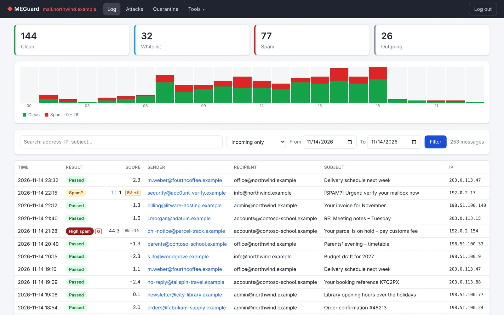
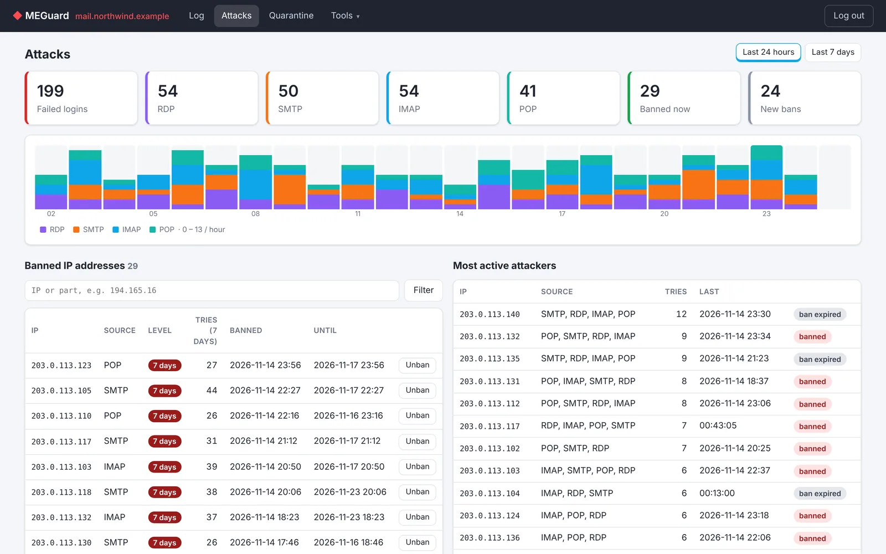

# MEGuard

**A free, open-source spam filter, log viewer and security toolkit for MailEnable on Windows.**
Built as a successor to **MxScan for MailEnable**, which has not been maintained for about a decade
and can no longer be licensed.

MEGuard runs entirely on your Windows mail server, in one folder (`C:\MEGuard`). No Linux, no cloud
service, no paid components, no subscription.

<picture>
  <source media="(prefers-color-scheme: dark)" srcset="docs/desktop-dark-log.webp">
  
</picture>

Website: **https://meguard.virtua.hu**

---

## What it does

**Filtering**
- Hooks into the MailEnable MTA **pickup event** – no extra SMTP proxy, no change to your MX records.
- Scores every incoming message with **SpamAssassin** (`spamd`; JAM Software's free *SpamAssassin for Windows*),
  kept alive by a watchdog, with nightly **Bayes training** from your own quarantine and Junk folders.
- Sender / recipient / IP **whitelists and blacklists** with wildcard patterns (MxScan-compatible).
- **Keyword rules** with scores – plain text (case- and accent-insensitive) or regular expressions.
- **DNS blocklists** checked against the *real* client IP taken from the MailEnable queue file.
- Optional **country score** for the sending server's country, and an automatic **repeat-sender** block.
- **Quarantine** with one-click release; low scores are tagged and delivered to the Junk folder.
- **Fail-open**: if anything goes wrong inside MEGuard, the message is delivered untouched. MEGuard never loses mail.

**Web interface** (single administrator, password + IP lockout, CSRF/CSP hardened, light and dark mode, mobile-friendly)
- **Log viewer** with a per-message breakdown of the decision and one-click whitelist/blacklist.
- **Attacks**: failed logins and bans per protocol (SMTP, POP, IMAP, RDP), most targeted accounts.
- **Country filter**: allow-list for the login ports (POP, IMAP, submission, RDP), built from the official
  RIR delegation files and applied as Windows Firewall rules; port 25 and webmail stay open. Off by default.
- **Resources**: CPU / memory / disk load, mail queues, MailEnable service status and restart buttons.

<picture>
  <source media="(prefers-color-scheme: dark)" srcset="docs/desktop-dark-attacks.webp">
  
</picture>

**Protection and self-healing**
- **IPBan** (DigitalRuby, MIT) installer, preconfigured for MailEnable SMTP/POP/IMAP and RDP, with escalating bans.
- **Health watchdog** every 3 minutes: restarts a hung SpamAssassin or a stopped mail service and e-mails you.
- **Daily backup** of the database and settings into a dated ZIP.

**Migration from MxScan** (optional): imports your MxScan whitelists, blacklists and keyword rules
(`tools\mdb_export.cmd` + `tools\import_mxscan.php`) and can run next to MxScan until you switch over.
MxScan is not required: on a fresh MailEnable server MEGuard starts with SpamAssassin's rules and its built-in defaults.

**Not included yet:** MEGuard does not scan for viruses. Planned for 0.4.0: optional attachment scanning with the
Microsoft Defender engine built into Windows Server, plus blocking of dangerous file types. Until then, keep
MailEnable's antivirus filter or your antivirus product.
Disable MailEnable's own SpamAssassin and Bayesian filters once MEGuard filters your mail (see INSTALL.md).

## Requirements

- Windows Server 2016 or newer, x64 (2012 R2 with PowerShell 5.1 should work)
- MailEnable Standard or Professional (Enterprise is untested)
- A web server for the interface: **IIS** (MailEnable's own web mail runs on it) or **Apache** (e.g. XAMPP)
- PHP 8.1+ with `pdo_sqlite`, `mbstring`, `iconv` – or let MEGuard install **its own PHP**
  (`tools\install-php.cmd`), which leaves any PHP already on the server untouched

## Installation

See **[INSTALL.md](INSTALL.md)**. In short:

1. Unzip to `C:\MEGuard`, copy `config.sample.php` to `config.php` and check the MailEnable folder.
2. Run `tools\install-php.cmd` (if needed), `tools\install-spamd.cmd`, `tools\install-ipban.cmd`, `tools\install-health.cmd`.
3. Web interface: `tools\install-iis.cmd` (IIS) or a few lines of Apache configuration.
4. `tools\check.cmd` – then enter `C:\MEGuard\pickup.cmd` as the MTA pickup program in MailEnable.

Until the last step your mail flow is not touched, and undoing it is a single field in MailEnable Administrator.

## Status

Version 0.3.1 (0.3.0 was the first public release). MEGuard has been filtering mail in production on two
MailEnable servers (Standard and Professional) since November 2026. Please report problems and
false positives in the issue tracker.

## Licence and credits

MEGuard is released under the **MIT License** (see `LICENSE`). It installs, but does not include,
SpamAssassin (Apache License 2.0, packaged for Windows by JAM Software) and IPBan (MIT, DigitalRuby).
Country data comes from the public delegation files of AFRINIC, APNIC, ARIN, LACNIC and RIPE NCC.

MEGuard was conceived, specified and tested by a MailEnable administrator who relied on MxScan for
many years; the code was written with AI assistance (Claude, Anthropic).

MailEnable is a trademark of MailEnable Pty. Ltd. MEGuard is an independent project, not affiliated
with or endorsed by MailEnable or by the former MxScan vendor.
